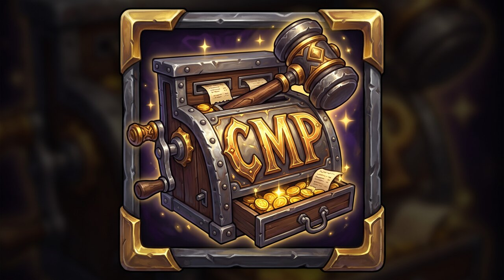

<p align="center">
  
</p>

<h1 align="center">CueTheCashier: Maximum Profit</h1>

<p align="center">
  An auction house and crafting profit addon for <b>World of Warcraft Forever</b>.<br>
  Scan the auction house, see what every craft is worth, and keep track of your gold.
</p>

<p align="center">
  <b>Public beta</b> · version 0.45.0 · GPL-3.0 · <code>/cmp</code>
</p>

---

> **This is a beta.** Most of it works and is used every day, but some parts have only been tested by
> a computer, not in the game yet. Please read [Help test the beta](#help-test-the-beta) and tell us
> what you find. Your saved data is kept from version to version.

## What it does

CueTheCashier (CMP for short) watches the auction house for you and turns what it sees into answers:
what to craft, what to buy, what to post, and at what price. It looks and feels like the game's own
windows, and you can give it your own look with a skin.

- **Auction house scanning.** One button scans the whole auction house. Prices show on every item
  tooltip, with 7-day and 30-day averages.
- **Craft profit for every profession.** Your professions are found by themselves, including gathering
  and secondary skills (on Forever, Skinning, Herbalism, Mining and Fishing have recipe windows too).
  Each recipe shows its cost, what it sells for and the profit, right in the game's profession window.
- **Crafting List and Task List.** Queue up profitable crafts in one click. The Task List tells
  you what to buy and where (auction house, vendor, mailbox, bank or one of your alts), and starts each
  craft in one click once the reagents are in your bags.
- **Groups and operations.** Sort items into groups and give each group rules for posting, buying,
  crafting, mailing, selling to vendors and banking.
- **Posting and cancelling.** Post Scan lists what to post and at what price; Cancel Scan finds your
  auctions that were undercut.
- **Deals.** Search for items selling below vendor price or below their disenchant value, or let the
  Snipe tab watch for cheap new postings.
- **Ledger.** Every purchase and sale, your profit per item, and gold per day across all your characters.
- **Your own sale numbers.** Sale rate, sold per day and average sale price, worked out from your own
  auction mails, plus region-wide prices from every server type you play on.
- **One-key macro.** Bind one key and press it to post, cancel, buy or disenchant, one step at a time.
- **Mail and bank helpers.** Open all auction mail at once, send items to your alts by rule, and move
  stock between bags and bank.
- **Skins.** Change the colours and look with a tiny skin addon. A dark skin is included as an example.

## Install

1. Download the latest `CueTheCashier-x.y.z.zip` from the [Releases](../../releases) page.
2. Close the game.
3. Unzip it. You get six folders:

   | Folder | What it is |
   |---|---|
   | `CueTheCashier` | The core: prices, tooltip, main window, settings, `/cmp`. Needed by all the others. |
   | `CueTheCashier_Auctioning` | Auction house scanning, buying, posting and the deal tabs. |
   | `CueTheCashier_Crafting` | Professions, craft profit, Crafting List and Task List. |
   | `CueTheCashier_Accounting` | The ledger, gold history and your own sale numbers. |
   | `CueTheCashier_Destroying` | The Destroy list and disenchant records. |
   | `CueTheCashier_History` | 30 days of daily prices (data only). |

4. Copy all six into the Forever AddOns folder:

   ```
   World of Warcraft\_forever_\Interface\AddOns\
   ```

   Note the `_forever_` part. The `_retail_` or `_classic_` AddOns folders won't work.
5. Start the game. On the character screen, open **AddOns** and check that all six are turned on.
6. Log in and type `/cmp status`. It shows the version and which modules are loaded.

To update, close the game, delete the six old folders and copy in the new ones. Your data is kept: it
lives in `WTF\Account\<account>\SavedVariables\CueTheCashier*.lua`, not in the AddOns folder.

You can turn a module off in the AddOns list if you don't want that feature. Only the core is required.

## Getting started

1. **Scan the auction house.** Open the auction house, click **Craft Trade** next to the close button,
   then **Full Scan** (bottom right). The game allows one full scan every 15 minutes. Prices now show
   on item tooltips.
2. **Open each profession once.** That's how CMP learns your recipes. From then on, every recipe in the
   profession window shows its profit (green) or loss (red).
3. **Queue some crafts.** In a profession window, click **Craft List** and pick **All profitable
   recipes**. Then open the **Task List** (right-click the minimap button) to see what to buy and what to craft.
4. **Open the main window** with `/cmp` or the minimap button. Start with the Overview, then make a few
   groups when you are ready.

## Using it

### Auction house: the Craft Trade window

Click **Craft Trade** on the auction house to switch to CMP's own auction window; its **Auction House**
button switches back. Its tabs:

- **Buy**: search with level boxes, a "max % of value" filter, and saved searches.
- **Sell**: post one item by hand, with the current listings beside it.
- **Auctions**: your auctions that are up now.
- **Post**: **Post Scan** lists bag items with the price and amount your Posting operations give.
  **Cancel Scan** lists your auctions that someone undercut. The button at the bottom right posts or
  cancels the top line, one click each.
- **Vendor**: items on the auction house priced below what a vendor pays for them.
- **Snipe**: watches for new postings priced well under market value (60% by default) or under vendor price.
- **Disenchant**: gear selling below what it disenchants into.
- **Shopping**: buys what your Crafting List still needs, up to 120% of the price it planned for.
  **Group Scan** looks up everything in your groups that has a Shopping operation.

**Every purchase asks first.** WoW Forever doesn't let addons buy from a plain button click, only from a
confirm box. This isn't something an addon can change. Posting doesn't need a confirm box.

### Professions, Crafting List and Task List

CMP keeps the game's profession window and adds to it. Under the selected recipe you get **Craft cost**,
**Sells for** (after the auction house cut) and **Profit**; hover them to see each reagent's price and
where it comes from. Reagents are priced at the cheapest of the auction house, a vendor, or crafting
them yourself with a recipe any of your characters knows.

- **Craft List** button (next to Create All): adds all profitable recipes, only this profession's, your
  restock rules, or everything from chosen groups. The **Queue...** button on the Crafting List does the
  last one too.
- **Crafting List**: left-click a row for one more, right-click for one less. **Craft** makes the next
  recipe the open window can make. Reagents worth crafting yourself are added and made first.
- **Task List** (called Shopping List before 0.45.0): first **Profession crafts**, the crafts on the
  list; click one to open its profession and start it, only when every reagent is in your bags (otherwise
  it tells you what is missing). Then what the list needs that you don't have, sorted by where to get it. It pops up at
  the auction house, a merchant, the mailbox or the bank when there is something for you there. At a
  merchant, **Buy Reagents** buys exactly what's missing. Clicking a vendor row puts a map pin on the
  nearest vendor you have visited that sells it.
- **Restock**: under a recipe, set **Keep in stock** and **Min profit** to keep that many on hand
  across all your characters.
- **Craft timer**: when you craft several, the cast bar shows time so far and time for the whole batch.

### Groups

The **Groups** tab of the main window holds a tree of groups and sub-groups. An item can be in more
than one group; each item ranks its groups 1, 2, 3, and rank 1 wins when they disagree. The **Base
Group** holds every item in the game and always comes last. In a profession window, **Make Group**
builds a group for that profession with Items and Materials sub-groups. Groups can be exported as text
and shared.

### Operations and price formulas

Operations are rule sets you make on the **Operations** tab and pick per group: **Posting**,
**Shopping**, **Crafting**, **Mailing**, **Vendoring** and **Warehousing** (bank). Every kind comes with
a **Base** operation on the Base Group as a starting point.

Price fields take formulas. Use price sources (`market`, `min`, `7d`, `30d`, `vendor`, `vendorbuy`,
`de`, `crafting`, `salerate`, `regionmarket` ...), money (`1g 50s`), percent (`90%`), maths and `min()`,
`max()`, `avg()`, `first()`. For example:

```
max(min(market, 7d) * 90%, vendor * 2)
```

Save a formula on the **Prices** tab as a custom price and use it by name. `/cmp sources <item>` shows
every source with that item's values.

Forever defaults: posting undercuts by 0 copper (Forever sells same-price auctions newest first, so
undercutting only costs you), and crafting wants at least 30% profit over the craft cost.

### Mailbox and bank

- **Open Mail** (Inbox tab): click to take items from expired, cancelled and won auctions; right-click to
  take the gold from sales.
- **Send Mail**: the small arrow right of the To: box opens a menu with your alts, recent names, friends
  and guild, and **Send by Mailing operations**, which mails group items to the characters your rules name.
- **Bank Moves** (bank window): **To Bank** and **To Bags** by your Warehousing operations, or a whole group.
- **Sell to Vendor** (merchant window): sells what you bought to vendor, and with Shift also items whose
  Vendoring operation says so.

### Ledger, gold and sale numbers

The **Ledger** tab lists what you bought and sold on the auction house and at vendors, profit per item,
and other costs (repairs, postage, cut, lost deposits). It reads your auction mails, so open your mailbox
now and then. The **Gold** tab shows gold per day for all your characters; the **Inventory** tab shows
what every character has in bags, bank, mail and on the auction house.

From your ledger CMP works out each item's **sale rate** (how many of your auctions sold),
**sold per day** and **average sale price**. Every character on the same server type and faction
adds to it.

Forever has several server types (Normal, PvP, Roleplay...) in one region. CMP merges what all your
characters saw into **region** prices and numbers. Stackable items (herbs, ore, leather, cloth,
potions...) seem to share one auction house across server types, so a scan on any of your characters
counts for all of them. Turn that off under Settings > Auction house if it looks wrong.
`/cmp region <item>` shows what each server type saw.

### One-key macro and Destroy list

Type `/cmp macro` to make a macro called "CueTheCashier", then drag it to an action bar or bind it to a
key. Each press does the next useful step: accepts a CMP confirm box, posts or cancels the next line on
the Post tab, buys the selected deal, or disenchants the top item on the Destroy list. You can also set a
modifier key plus the scroll wheel to press it (Settings > Auction house > One-key scroll wheel).
`/cmp macro next` tells you what the next press will do.

`/cmp destroy` opens the **Destroy list**: gear in your bags worth disenchanting, best first.

### Tooltips

Item tooltips show market value, lowest buyout, averages, vendor price, disenchant value and materials,
craft cost, your groups, sale numbers and region prices. Every line can be turned off in
Settings > Item tooltips.

### Skins

Pick a skin under Settings > General > Skin, then `/reload`. To make your own, create a tiny addon with
one `CueTheCashier.Skins:Register(...)` call. [`CueTheCashier/SKINS.md`](CueTheCashier/SKINS.md) walks
you through it and lists every field; `CueTheCashier/SkinDark.lua` is a full example.

## Slash commands

`/cmp help` lists everything. The ones you'll use most:

| Command | What it does |
|---|---|
| `/cmp` | Open or close the main window |
| `/cmp settings` | Open the settings |
| `/cmp status` | Version and which modules are loaded |
| `/cmp price <item>` | Prices for an item (link, ID or name) |
| `/cmp sources [item]` | Every price source, with the item's values |
| `/cmp region <item>` | What each server type in your region saw |
| `/cmp vendor <item>` | Vendor buy and sell price |
| `/cmp fullscan` | Full auction house scan (auction house must be open) |
| `/cmp ledger` | Open the ledger |
| `/cmp prof` | Professions report (written to the log) |
| `/cmp prof list` | Open the Crafting List |
| `/cmp prof queue` | Queue crafts from chosen groups |
| `/cmp prof tasks` | Open the Task List (`auto` turns pop-ups on or off; `/cmp prof shop` still works) |
| `/cmp prof top` | Your most profitable known recipes |
| `/cmp prof restock` | Show what your restock rules would do |
| `/cmp prof max <percent>` | Highest price to pay for reagents, as % of planned (default 120) |
| `/cmp prof buy` | Buy missing reagents at the open merchant |
| `/cmp prof dock` | Put the Crafting List back next to the profession window |
| `/cmp prof vendors` | Vendors you have visited |
| `/cmp macro [wheel\|next]` | Make the one-key macro, or see its next step |
| `/cmp destroy` | Open the Destroy list |
| `/cmp dis` | Your disenchant results compared with the expected table |
| `/cmp mail` | Mailing report |
| `/cmp minimap` | Show or hide the minimap button |
| `/cmp skin [name]` | List skins or pick one |
| `/cmp realm` | Server type and region info |
| `/cmp debug [verbose]` | Debug mode on or off |
| `/cmp log` | Open the debug log (you can copy from it, unlike chat) |
| `/cmp reset` | Delete saved prices for this server type and faction (careful) |

`/cm` and `/cuethecashier` work too.

## Help test the beta

Everything below is built, but hasn't been fully checked in the game yet. If you use any of it, we'd love
to hear whether it works for you, even if the answer is just "fine". Step-by-step test lists are in
[`CueTheCashier/TESTING.md`](CueTheCashier/TESTING.md).

| Feature | Since | What to check |
|---|---|---|
| [Task List and Profession crafts](CueTheCashier/TESTING.md#task-list-and-low-data-0450) | 0.45.0 | Click a craft on the Task List: does it open the right profession and start crafting? With a reagent missing, it should only tell you what's missing. |
| [Low data mark](CueTheCashier/TESTING.md#task-list-and-low-data-0450) | 0.45.0 | Sale rate lines from only a few auctions say "(low data)". |
| [Shared commodity prices](CueTheCashier/TESTING.md#shared-commodity-prices-0440) | 0.44.0 | Do stackable items really share one auction house across server types? Scan the same item (say Light Leather) on two server types a few minutes apart and compare with `/cmp region`. |
| [Sale rate and region numbers](CueTheCashier/TESTING.md#sale-rate-and-region-0430) | 0.43.0 | Do sale rate, sold per day and average sale look right next to what you remember selling? |
| [Base operations and craft queue](CueTheCashier/TESTING.md#defaults-lists-and-craft-queue-0420) | 0.42.0 | The "Not enough on the auction house?" box, the craft timer, the Crafting List remembering its place. |
| [Queue from groups](CueTheCashier/TESTING.md#queue-from-groups-0422) | 0.42.2 | The **Queue...** button on the Crafting List. |
| [Send Mail arrow](CueTheCashier/TESTING.md#send-mail-arrow-0423) | 0.42.3 | The menu next to the To: box, and mail to two-part names (first name and surname). |
| [Disenchanting](CueTheCashier/TESTING.md#destroying-cuethecashier_destroying) | 0.12.0 | Forever may disenchant differently from the classic table. Disenchant a few items, then run `/cmp dis`. |
| Neutral auction houses | 0.34.0 | The cut at Booty Bay, Gadgetzan and Everlook is assumed to be 15%. Is it? |
| PvP, Roleplay and Hardcore servers | 0.37.0 | Does `/cmp realm` name your server type correctly? Most testing so far was on EU Normal, Alliance. |
| Other addons | 0.40.0 | Do our buttons and the Crafting List find a free spot next to your UI addons (ElvUI, profession addons...)? |

Also very welcome: US region players, Horde players, and anyone with several characters and professions.

## Feedback, bugs and ideas

Everything goes through [GitHub Issues](../../issues). You need a free GitHub account.

**Found a bug?** [Open a bug report](../../issues/new?template=bug_report.md) and include:

1. Your CMP version (`/cmp status`).
2. What you did, what you expected, and what happened instead.
3. Any Lua error text. If errors don't show, type `/console scriptErrors 1`.
4. The debug log, if you can: type `/cmp debug`, do the thing again, then `/cmp log`, **Pause**,
   **Select All**, Ctrl+C, and paste it into the issue.
5. Other addons you use, especially UI replacements.

**Have an idea or a wish?** [Suggest a feature](../../issues/new?template=feature_request.md). Tell us
what you are trying to do in the game, not just the button you want; that helps us find the best fix.

**Just want to say it works (or doesn't)?** That's useful too. Open an issue or comment on the beta
test issue for the feature.

Before opening a new issue, have a quick look whether someone already reported the same thing and add
to that one instead.

## FAQ

**Why does every purchase ask for confirmation?**
WoW Forever blocks addons from buying with a single click. A confirm box is the only way that works.

**My prices are empty after I installed.**
Run a full scan at the auction house first. Prices are saved per server type and faction.

**I don't see the Craft List button.**
Another addon may be covering it. Use the **Queue...** button on the Crafting List or `/cmp prof queue`,
and tell us which addon it was.

**Does it work on Classic, Season of Discovery or Retail?**
No, only on WoW Forever. It uses Forever's game data and its auction house rules.

**Does it read outside price data?**
Not yet. Everything comes from your own scans and mail. A desktop companion app is planned for later.

## For addon makers

CMP has a public API (`CueTheCashier.API`) for price sources, groups, the shopping list and more, and
you can write your own modules. See the API section in
[`CueTheCashier/README.md`](CueTheCashier/README.md#for-addon-makers-the-api) and `CueTheCashier/API.lua`.

Pull requests are welcome. Please open an issue first for anything big, so we can talk about it.

## Changelog

See [CHANGELOG.md](CHANGELOG.md). CueTheCashier was called **CraftMarket** before 0.38.0; the changelog
explains how to bring old saved data over.

## License

CueTheCashier: Maximum Profit is free software under the
[GNU General Public License v3.0](LICENSE) or later. You may use, share and change it; changed versions
you share must stay open under the same license.

Not made by or affiliated with Blizzard Entertainment. World of Warcraft is a trademark of Blizzard
Entertainment, Inc.
